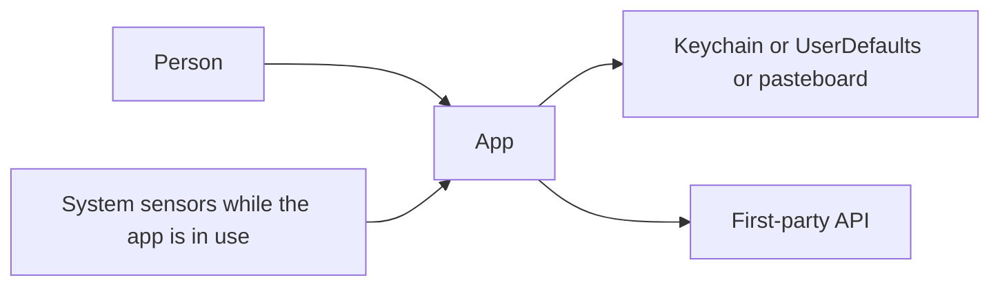

# CB67 — Privacy data-flow map

Checked against `origin/rc/20261108` at `88e981b3308558939e405606cd731b4b29fc9499` (2026-11-09 PT). Marketing version stays `0.1.0` (`1`). Source inspection only. This note does not sign, upload, deploy, or open a socket.

The owner summary is `docs/release/cb67-security-summary.md`. The threat rows are `docs/release/cb67-threat-model.md`.

Nutrition-label status follows `origin/cursor/cb55` (`docs/release/cb55-privacy.md`, `b75bdd223396844fcc6592e185b18c9d0cad68aa`). That draft is not submitted. A permission string, a DTO field, or an on-device read is not treated as collection. Apple’s “collect” means the app transmits the data off the device so the developer or a partner can access it for longer than real-time servicing of that request.

This tree's `Resources/PrivacyInfo.xcprivacy` is unchanged. It lists more collected types than the proven rows below. The manifest list is not proof. Types CB55 left unverified stay unverified.

## How a value moves

`Config/Base.xcconfig` leaves `QUESTIFY_API_BASE_URL` and `QUESTIFY_SESSION_REALM` empty and sets the bundle id to `invalid.example.questify.ios`. `ReviewedMarketLaunch.admitsShippedChina` is false for that empty URL, so `RegionalLaunchConfiguration.composition` is `makeComposition(reviewed: nil, build: .current)`. The API column is the source path. It is not a claim that the default build opens a connection.

There is no tracking hop. `NSPrivacyTracking` is false. `NSPrivacyTrackingDomains` is empty. No tracking SDK is in this map, because none was found and none is added. MetricKit is not a hop: nothing in this tree subscribes to `MXMetricManager`.

`https://www.chengyinhub.com/prod-api/` is the reviewed China API base URL in `Config/China.Production.xcconfig` and `ReviewedMarketLaunch.chinaProductionBaseURL`. It is not a privacy-policy URL. No privacy-policy URL is recorded.

## Proven flows

Linked means the same request carries the account token, or the registration is for the signed-in account. Tracking is No on every row. Purpose is App Functionality. This matches the CB55 draft.

| Data | On the device | Leaves the device | Sink in source | Linked | Tracking |
|---|---|---|---|---|---|
| Phone Number | Typed into the auth or registration sheet | Yes, on that request | `AuthChannelService.sendSMSCode` and `loginWithPhone` fields `phone` and `code`. `RegistrationUIForm` builds `realName` and `phone`. `RegistrationService.create` POSTs `api/registration/create`. | Yes | No |
| Name | `realName` on the same registration draft | Yes, on the create body | `RegistrationCreateIntent.encode` writes `realName`. | Yes | No |
| Precise Location | When-in-use sample. Background updates are forced off. | Yes, when a share grant is published | `PersonalLocationShareCoordinator.publishOne` builds latitude and longitude. `PersonalLocationShareHTTPService.publish` POSTs `grants/{id}/observations` and refuses a synthetic transport. Datum must be `WGS84`. | Yes | No |
| Photos or Videos | JPEG bytes the person chose to upload. A video file upload was not proven. | Yes, for those JPEGs | `ProfileAvatarUpload` POSTs `avatar.jpg`. Topic, story, and node image uploads build the same kind of JPEG body to `api/common/uploadOSS`. | Yes | No |
| Audio Data | Microphone clip bytes on the upload path. The on-device amplitude meter is not this row. | Yes, only when the uploader is enabled and `voiceCloning` is granted | `MerchantNPCVoiceUpload.upload` POSTs `audio/mp4` to `api/common/uploadOSS`. `init` defaults `enabled` to false and otherwise throws `disabled`. | Yes | No |
| Other User Content | In-app channel message text | Yes, on edit | `NativeChannelMessageContracts` puts `content` on the edit body. `NativeChannelMessageService` POSTs `api/im/message/edit`. | Yes | No |
| Fitness | `CMPedometer` cumulative steps. Not HealthKit. | Yes, on the step action when that service is enabled | `NativeStepContract.unsignedPayload` includes `cumulativeSteps`. `NativePlatformService.action` POSTs it. `stepsEnabled` defaults to false. The reply check expects `rewardEnabled == false` and status `AUDIT_ONLY`. | Yes | No |
| Device ID | App Attest key id already supplied to the provider. Not the advertising identifier. | Yes, on that same step request | The payload includes `deviceKeyId`. `AppAttestStepAssertionProvider` calls `DCAppAttestService.generateAssertion` and defaults `enabled` to false. | Yes | No |

## Stays on the device

| Data | Store | Leaves the device |
|---|---|---|
| Session token | Keychain generic password, `WhenUnlockedThisDeviceOnly`, not synchronizable, no access group | Only as the `Authorization` header on a later request. It is not written to `UserDefaults`. |
| Restore-blocked flag | `UserDefaults` boolean `restoreBlockedKey` | No. The flag is not the token. |
| Language, reduced motion, consent document versions | `UserDefaults.standard`, including `App/QuestifyApp.swift` `preferences.language` and `App/UsageConsentGateView.swift` | No send of those preference values was proven. Reason code in this tree's manifest: User Defaults `CA92.1`. |
| Search history | Keychain, `AfterFirstUnlockThisDeviceOnly`, ten strings, namespace suffix `.search.history` | No send of a stored search query was proven. CB55 left Search History unverified. |
| Copied text | Pasteboard. `LocalPasteboard` is `localOnly` and expires in 120 seconds. Three call sites on this tree are `localOnly` without an expiry (team invite, approved-media link, club AI promo). | The system share sheet and system text selection can hand text to another app. That is not an app network send. `hasStrings` on the club AI path reads pasteboard content. |
| File timestamps | `fstat` / `contentModificationDateKey` on the app's own temporary files, and `fstat` of a URL the person selected | Compared locally. Not proven to be sent. This tree's manifest declares File Timestamp `C617.1` only. |
| System boot time | `ProcessInfo.processInfo.systemUptime` subtracted for local deadlines | Not copied into an outbound absolute timestamp in the CB55 audit. Manifest reason `35F9.1`. `8FFB.1` and `3D61.1` are not declared. |
| Coarse location cell | Rendered for display by `PersonalLocationSharePolicy` | A transmitted coarse value was not proven. The proven publish body is precise. |

`3B52.1` is the File Timestamp reason CB55 records for files the person granted: `App/TemplateAudioDocumentPickerAdapter.swift`, `App/ProjectStoryAudioSelectedDocumentReader.swift`, and `Core/QmodArchiveInspection.swift` (`fstat` and `st_mtimespec` after `startAccessingSecurityScopedResource`). Those calls are in this tree. The string `3B52.1` is not in this tree's `Resources/PrivacyInfo.xcprivacy`. It is added on `origin/cursor/cb55`. This note does not edit the manifest.

Disk Space and Active Keyboards stay undeclared. CB55 found no `statfs` / `volumeAvailableCapacity` / `NSFileSystemFreeSize` and no `activeInputModes` on this same tree. `Core/AppStorePrivacyManifestAndPermissionAudit.swift` has an in-memory default that names Disk Space `E174.1`. That default is not the bundled manifest.

## In the manifest, not a proven flow

CB55 left these unverified and did not change the collected-type array. This note does not promote them.

| Manifest or nearby name | Why it is not a row above |
|---|---|
| User ID | `Account` decodes `id` or `userId` returned by the service. The client was not shown generating that id or placing it in an outbound body as a collected identifier distinct from the session token. |
| Email Address | `RegistrationCreateIntent` can encode `email` when a caller passes one. `RegistrationUIForm.details` passes `realName` and `phone` only. |
| Physical Address | `ParticipantForm` visible fields are `fullName` and `mobilePhone`. `detailAddress` is copied from a loaded participant and written back only when that loaded value is non-empty. |
| Purchase History | The pay-parameter builder uses a registration id and says constructing the request does not send it. Empty StoreKit product identity keeps virtual goods off. |
| Payment Info | The pay body is a registration id, not a card number. Bank-card withdrawal stays behind `.bankPrepare` and `.bankConsentRead`. |
| Coarse Location | Display cell only, as above. |
| Health | `IPhonePedometerProvider` uses `CMPedometer` only. |
| Contacts | No `CNContact` collection was found. |
| Emails or Text Messages | Channel text is Other User Content. An email or SMS body was not found. |
| Gameplay Content, Customer Support, Browsing History, Search History | No send of saved-game content, a support transcript, off-app browsing, or a stored query was proven. |
| Product Interaction, Advertising Data, Other Usage Data | No analytics or advertising SDK send was proven. |
| Crash Data, Performance Data, Other Diagnostic Data | No crash-log or performance-metric upload was proven. MetricKit is not subscribed. |
| Sensitive Info, Credit Info, Other Financial Info, Other User Contact Info, Environment Scanning, Hands, Head, Other Data | No matching collection was proven. |

## Required-reason APIs in this tree's manifest

| Category | Reason in `Resources/PrivacyInfo.xcprivacy` on this SHA |
|---|---|
| User Defaults | `CA92.1` |
| File Timestamp | `C617.1` |
| System Boot Time | `35F9.1` |

`NSPrivacyTracking` is false. `NSPrivacyTrackingDomains` is empty. Collected types, each linked, tracking false, purpose App Functionality: Phone Number, User ID, Precise Location, Photos or Videos, Audio Data, Other User Content, Name, Email Address, Physical Address, Purchase History, Fitness, Device ID. User ID, Email Address, Physical Address, and Purchase History are listed and still unverified, per the table above.

`Vendor/GLTFKit2/GLTFKit2/PrivacyInfo.xcprivacy` sets tracking off and leaves collected-data and accessed-API arrays empty.

## Legal text, support, and ICP

These three values are placeholders. This note does not fill them.

| Placeholder | Tree fact |
|---|---|
| `[LEGAL_TEXT_PENDING]` | Served China privacy policy is `.missing(.pendingSourceText)` while `privacyPolicyApproved` is false (`SettingsSourceLegalCatalog`, `SettingsBundledLegalReader.defaultPrivacyPolicyApproved == false`). This note does not quote the document constant that appears only when that flag is true, and it does not quote the user-agreement or cancellation-notice constants. No privacy-policy URL is recorded. |
| `[SUPPORT_CONTACT_PENDING]` | The withdrawal support reader embeds no production contact (`docs/withdrawal-support-configuration.md`). This note does not copy a telephone number or street address out of the legal catalog. No support URL is recorded. |
| `[ICP_FILING_NUMBER_PENDING]` | `VersionedLocaleDisplay.legalGateStatus(.icpFiling)` returns `NOT_RUN`. No filing number is written. |

## Location and background keys

When-in-use remains the usage string in `Config/Base.xcconfig` and `Resources/InfoPlist.xcstrings`. This note does not add `NSLocationAlwaysUsageDescription`, `NSLocationAlwaysAndWhenInUseUsageDescription`, or `UIBackgroundModes`. `App/PersonalLocationShareHost.swift` sets `allowsBackgroundLocationUpdates = false`.

## What this map does not add

No tracking SDK. No MetricKit subscription. No privacy-policy URL. No change to version `0.1.0` (`1`). No edit to Swift, the privacy manifest, xcconfig, workflows, or `tools/current_ci_manifest.json`. The archive privacy report and the final nutrition label stay with the owner (FP-O4 and FP-O8 in `docs/parity/fix-plan.md`).
