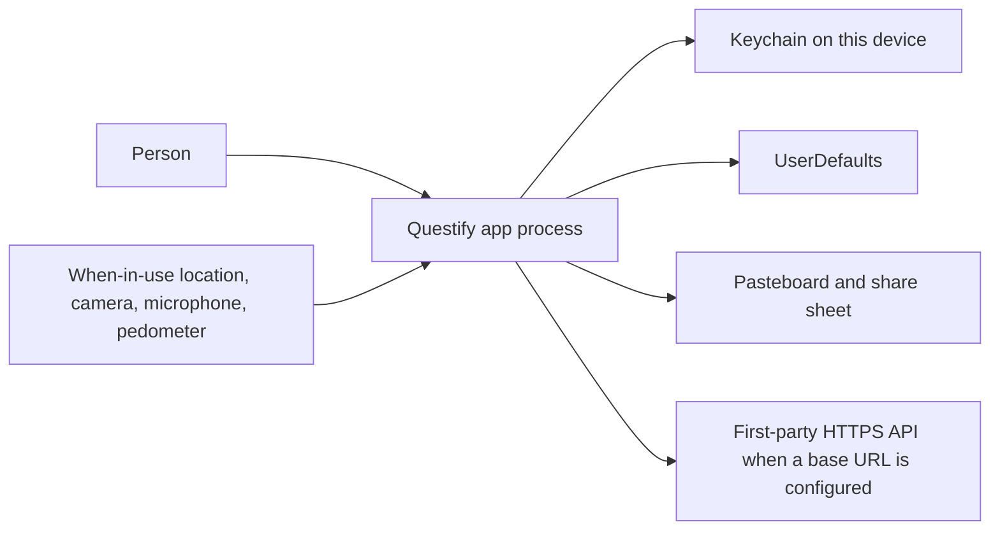

# CB67 — Threat model

Checked against `origin/rc/20261108` at `88e981b3308558939e405606cd731b4b29fc9499` (2026-11-09 PT). Marketing version stays `0.1.0` (`1`). Source inspection only. This note does not sign, upload, deploy, or open a socket.

The short owner summary is `docs/release/cb67-security-summary.md`. The flow table is `docs/release/cb67-privacy-data-flow.md`.

`origin/cursor/cb38` (`daef60be85ec2748587e774c4311192d22308120`, note `docs/release/cb38-security.md`) and `origin/cursor/cb55` (`b75bdd223396844fcc6592e185b18c9d0cad68aa`, note `docs/release/cb55-privacy.md`) were read. This note describes this tree. It does not treat unmerged edits on those branches as present here, and it does not restate their findings as if they were wrong.

## Assets

| Asset | Where it lives on this tree |
|---|---|
| Session token | Keychain generic password, account `session-token`, via `App/KeychainTokenStore.swift`. Sent on `Authorization` by `Core/AuthRequestBuilder.swift`. |
| Phone number and SMS code | Request fields of `Core/AuthChannelService.swift` `sendSMSCode` and `loginWithPhone`. Registration can also send `phone` with `realName` (`Core/RegistrationService.swift` `create` to `api/registration/create`). |
| Apple identity token | `loginWithApple` sends `identityToken`. The client comment says this is transport validation, not a local JWT signature check. |
| Precise location | `PersonalLocationSharePublish` latitude and longitude, datum `WGS84`, posted to `grants/{id}/observations` by `Core/PersonalLocationShareHTTPService.swift`. |
| Photos | JPEG bodies from `Core/ProfileAvatarUpload.swift`, `Core/ProjectTopicImageUpload.swift`, `Core/ProjectStoryImageUpload.swift`, and `Core/ProjectNodeImageUpload.swift`. |
| Audio | `Core/MerchantNPCVoiceUpload.swift` can POST `audio/mp4` to `api/common/uploadOSS`. The initializer defaults `enabled` to false. |
| Channel text | `content` on the edit body, `POST api/im/message/edit` (`Core/NativeChannelMessageService.swift`). |
| Step count and device key id | `Core/NativeStepContract.swift` `unsignedPayload` includes `cumulativeSteps`. The same request can send `deviceKeyId`. `App/AppAttestStepAssertionProvider.swift` defaults `enabled` to false. `Core/NativePlatformService.swift` defaults `stepsEnabled` to false. |
| Search history | Keychain item under `App/SearchMapComponents.swift` (`SearchMapLocalHistory`). Ten strings. Not proven to leave the device. |
| Consent and preference flags | `UserDefaults`: language, reduced motion, agreed document versions, `restoreBlockedKey` boolean. |
| Copied text | `UIPasteboard`, through `LocalPasteboard` or a direct `setItems`. |

Legal text, the published support contact, and the China ICP number are not assets in this note. They are the placeholders `[LEGAL_TEXT_PENDING]`, `[SUPPORT_CONTACT_PENDING]`, and `[ICP_FILING_NUMBER_PENDING]`.

## Trust boundaries

The default build does not configure that API. `Config/Base.xcconfig` leaves `QUESTIFY_API_BASE_URL` and `QUESTIFY_SESSION_REALM` empty. `ReviewedMarketLaunch.admitsShippedChina` requires the reviewed China host plus a usable bundle and realm, so `RegionalLaunchConfiguration.composition` stays `makeComposition(reviewed: nil, build: .current)`.

Diagnostic views stay inside the app box. They are not a fifth network hop. MetricKit is not subscribed: there is no `import MetricKit` and no `MXMetricManager`.

No tracking SDK sits on either side of the API boundary. `NSPrivacyTracking` is false and `NSPrivacyTrackingDomains` is empty. This note does not add one.

## Actors

- The person holding the unlocked device.
- Another app on the same device that can read a general pasteboard item or receive a share-sheet item.
- A caller who opens a URL, a QR string, or a push payload.
- The first-party API, once a reviewed base URL is actually configured.
- The process that builds and signs the archive. No certificate, profile, or team is in this tree.

## Threats

Each row is a loss this tree already has a control for, and the residual that remains on this SHA. No new control is implemented here.

| ID | Asset | Loss | Control in this tree | Residual on this tree |
|---|---|---|---|---|
| CB67-01 | Session token | Read from a synced or shared Keychain item | `kSecAttrSynchronizable` false. `kSecAttrAccessibleWhenUnlockedThisDeviceOnly` on write. No access group. Entitlements file is Sign in with Apple only. | No `kSecAccessControl` biometric ACL. `kSecUseDataProtectionKeychain` is not set. CB38 left both, because a new attribute on the query could miss an item already stored for a signed-in user. This note does not run a device check. |
| CB67-02 | Session token | Written beside preferences | Writes go through `KeychainTokenStore.write` from login and channel commit in `App/AppSession.swift`. The restore-blocked flag is a boolean. `App/UsageConsentGateView.swift` states that consent storage does not hold tokens. | A line-by-line log audit was not done. This note adds no logging. |
| CB67-03 | Token and bodies | Cleartext hop or a cached `Authorization` value | ATS exception keys are absent, so the system HTTPS default applies. `AuthRequestBuilder` refuses a token outside printable ASCII and sets `reloadIgnoringLocalCacheData`. | No certificate pin is claimed. The fixture string `http://invalid.example/image.png` in `App/ReferenceMapCardFixtureView.swift` is not an ATS exception. |
| CB67-04 | Phone, SMS code, Apple token | Client accepts a credential the server should reject | Phone and code are request fields. The Apple token is exchanged with the backend. Release builds compile out password login (`passwordLoginCompiledIn` is DEBUG-only) and return `auth.notConfigured`. | Local code does not verify the Apple JWT signature. WeChat auth configuration on the shipping session is nil. |
| CB67-05 | Routes and referral ids | A link, QR string, or push opens a route or carries a user and password in the URL | `NativeEntryLinkPolicy` requires https, no user, no password, no port, no fragment, length at most 8192, and a host on the allowlist. The allowlist is empty, so the result is `.routeError(.unsupported)`. `DoorLinkPolicy` has the same empty default. `PushTapRouter()` has no route keys, and `parseInternal` accepts only scheme-less, host-less paths. No custom scheme is registered. `questify://` strings in `App/PushNotificationAndLiveActivitySectionView.swift` are diagnostic copy. | `App/NativeQRScanner.swift` returns one raw string. CB38 records that each caller validates its own payload and that this was not re-certified on a device. The empty allowlist stays empty. |
| CB67-06 | Copied text | Another app reads an invite code, link, promo line, phone, or order number, or a paste notice reads content | `LocalPasteboard.copy` is `localOnly` and expires after 120 seconds. Direct writes that already set `localOnly` and an expiry include withdrawal support (120s), order numbers (120s), webhook credentials (120s, selection disabled), settlement (120s), merchant engagement phones (60s), merchant business records (120s), and cooperation phones (120s). WeChat bridges call the vendor completion only on the main thread, for the current attempt, when `pasteboardReadApproved` is true. That flag defaults to false, and the shipping configuration is nil. | Still without an expiry: team invite copy, approved-media link copy, and club AI promo copy. Club AI also requires `hasStrings`. `origin/cursor/cb38` records those four fixes. They are not in this commit. `ShareLink(item: code)` remains on the team invite. System text selection is not forced through `LocalPasteboard`. |
| CB67-07 | Search history | Readable after first unlock while the device is locked, or a large blob is decoded | Accessibility class on insert is `kSecAttrAccessibleAfterFirstUnlockThisDeviceOnly`, which is this-device-only. `SearchHistoryPolicy` keeps ten strings. A nil namespace stays in memory. | The query does not name `kSecAttrSynchronizable`. The default is non-sync, and the attribute is implicit. Read does not reject a different accessibility class and does not cap the blob before `JSONDecoder`. CB38 set the sync attribute on its branch and did not migrate the accessibility class. Neither change is in this tree. |
| CB67-08 | Precise location | Collection continues in the background, or an Always prompt appears | Usage string is when-in-use. `allowsBackgroundLocationUpdates` is set false on init and on stop. Publish requires finite WGS84 coordinates and refuses a synthetic transport. Contract checks reject always-location keys and `UIBackgroundModes`. | `Core/PersonalLocationSharePolicy.swift` can render a coarse cell for display. CB55 did not prove a transmitted coarse value. The proven body is precise. |
| CB67-09 | Photos and audio | Library video or a microphone clip leaves the device without the matching path | `NSPhotoLibraryUsageDescription` stays out of `Config/Info.plist`. The installed photo key is add-only. Proven photo bytes are JPEGs posted as multipart. The voice uploader returns `MerchantNPCFailure.disabled` unless `enabled`, `voiceCloning`, and the upload approval all hold. | A video-file upload was not proven. The microphone purpose string also describes an on-device amplitude path. CB55 counts the upload path as the Audio Data collection, not the meter. |
| CB67-10 | Steps and `deviceKeyId` | Treated as an advertising identifier or a reward proof | Provider string is `IOS_CMPEDOMETER_V1`. `stepsEnabled` defaults to false. The service checks `rewardEnabled == false` and status `AUDIT_ONLY` on the reply. App Attest `generateAssertion` runs only when that provider is enabled, and it defaults to false. No `ASIdentifierManager` or `identifierForVendor` call was found. | The privacy manifest lists Device ID. That row is this key id, not the advertising identifier. HealthKit was not found. The declared type is Fitness, not Health. |
| CB67-11 | Channel text | Message content is shared as mail or SMS | The proven send is the in-app edit body. | An email or SMS body was not found. |
| CB67-12 | Payment instruments and purchases | A card number or a virtual-goods receipt leaves the device | `makeBankWithdrawalContext` returns nil unless `.bankPrepare` and `.bankConsentRead` are permitted. This note does not permit them. Empty StoreKit product identity keeps that launch off. `OrderLifecycleRequestContract` builds `api/registration/pay/app` with a registration id, and the file says constructing the request does not send it. | The manifest still lists Purchase History. CB55 left Purchase History and Payment Info unverified. This note does the same. |
| CB67-13 | Crash and performance data | Stacks or metrics are uploaded | No upload of crash logs or performance metrics was proven. `ProcessInfo.processInfo.systemUptime` is a local elapsed-time clock under reason `35F9.1`. | Views and an audit struct use the word MetricKit. They describe local categories (`crash`, `hang`, `cpu`, `disk write`) and a 250ms budget. They do not call `MXMetricManager`. MetricKit is not subscribed. |
| CB67-14 | Cross-app tracking | An SDK or the advertising identifier links activity across apps | Manifest tracking flag and domain list are off. `Vendor/GLTFKit2` manifest matches, with empty collected-data and accessed-API arrays. The source search named in the summary found no ATT, AdSupport, or the named analytics SDKs. The WeChat SDK binary is not in this tree, so its own privacy manifest was not copied (CB55). | This is not an archive privacy report. No tracking SDK is invented to fill that gap. |
| CB67-15 | Account, policy, filing | A deletion, a policy URL, or an ICP number is described as shipped | Unconfigured composition shows the blocked 账号注销 row and does not send `POST api/user/deregister/apply`. China privacy policy resolves to `.missing(.pendingSourceText)` while `privacyPolicyApproved` is false. `VersionedLocaleDisplay.LegalGate.icpFiling` stays `NOT_RUN`. | Whether the blocked row is enough for App Review is an owner decision (`docs/release/ship-prep.md`). Legal text, support contact, and the ICP number in this note are the placeholders below. |

## Placeholders

| Token | Meaning |
|---|---|
| `[LEGAL_TEXT_PENDING]` | No legal sentence is printed in this note. The served China privacy-policy document is pending source text unless `privacyPolicyApproved` is true. The default reader flag is false. No privacy-policy URL is named. |
| `[SUPPORT_CONTACT_PENDING]` | No support URL, telephone number, or street address is printed in this note. |
| `[ICP_FILING_NUMBER_PENDING]` | No China ICP filing number is printed in this note. |

The API host `https://www.chengyinhub.com/prod-api/` is a reviewed China base URL. It is not a privacy-policy URL, not a support URL, and not an ICP number. The target base configuration does not select it, because the URL and realm in `Config/Base.xcconfig` are empty.

## Out of scope for this note

CB38's pasteboard expiry, `hasStrings` removal, and explicit search-history `synchronizable` flag stay on `origin/cursor/cb38`. CB55's `3B52.1` manifest string stays on `origin/cursor/cb55`. Copying either edit would touch Swift or `Resources/PrivacyInfo.xcprivacy`. This branch does not.

No Keychain item is deleted. No access group is added. No ATS dictionary is added. No host is added to the link allowlist. Password login, bank-card withdrawal, and virtual goods stay off. Version stays `0.1.0` (`1`).
