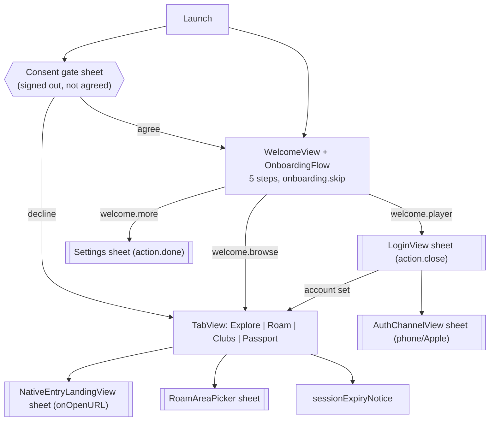
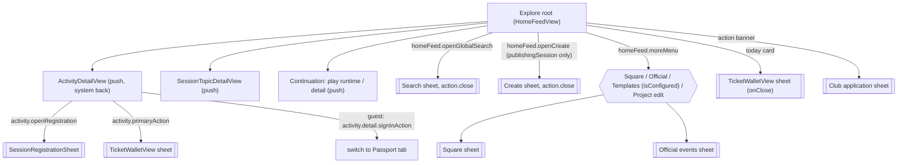
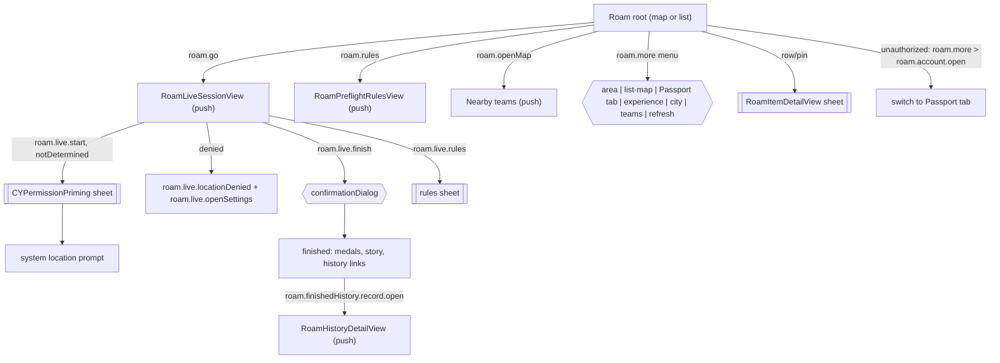
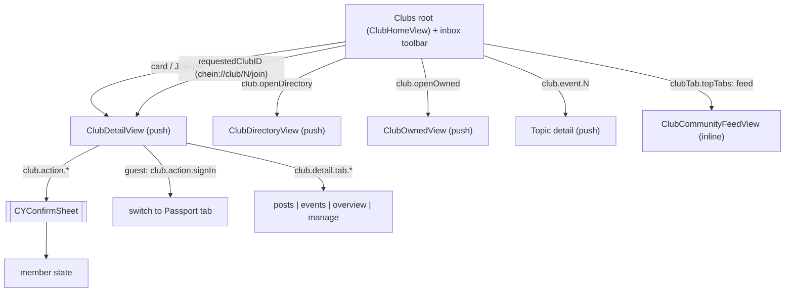
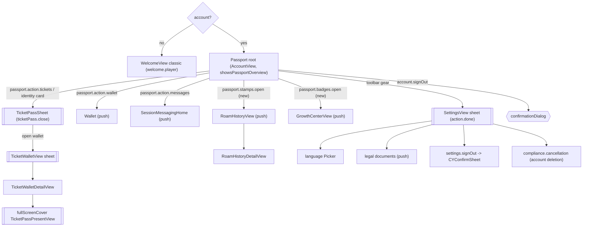

# Player page-flow audit

Base `f25775fff` (`origin/ui/main`), branch `ui/e1f`. Code-only trace: nothing here was built or run. Player side only; merchant mode is out of scope.
Sources read: `App/QuestifyApp.swift` (`SessionRootView`), `App/AppSession+DeepLink.swift`, `Core/CheinDeepLink.swift`, `Core/RootTab.swift`,
`App/WelcomeView.swift`, `App/DesignSystem/CYOnboarding.swift`, `App/UsageConsentGateView.swift`, `App/LoginView.swift`, `App/SessionHomeFeedView.swift`,
`App/ActivityDetailView.swift`, `App/RoamBrowserView.swift`, `App/RoamLiveSessionView.swift`, `App/PassportView.swift`, `App/AccountView.swift`,
`App/Ticket*.swift`, `App/ClubHomeView.swift`, `App/ClubDetailView.swift`, `App/ClubActionPanel.swift`, `App/SettingsView.swift`.

Tap counts are from a cold start. "Guest" = first launch, `onboarding.skip` (1) then `welcome.browse` (2), landing on Explore. A signed-in relaunch lands on Explore with 0 taps.
The consent gate (a non-dismissible sheet shown once per launch to a signed-out user who has not agreed) costs +1 tap (`authEntry.gate.agree` or `.decline`); declining sets `browsingAsGuest` and skips onboarding.

## 1. Flow graphs

### Root

### Explore

### Roam

### Clubs

### Passport

### Overlays on the root (all on `SessionRootView`, `chain5`/`chain6`)

Sheets owned by one root view: native-entry landing (`nativeEntry`), Roam area picker, consent launch gate, DEBUG scanner. A native URL arriving while the consent gate is up is the only realistic collision (see G3).
`chein://` links do not use a sheet: they select a tab and set a one-shot flag.

## 2. Journeys

Legend: states = Empty / Loading / Error / Offline / Unavailable (not configured) / Capability hidden. "–" = not applicable.

### J1 First launch → onboarding → guest browse — OK

| Step | Screen file | Control id | Taps | Back/close | States | Verdict |
|---|---|---|---|---|---|---|
| Consent gate | `UsageConsentGateView` | `authEntry.gate.agree` / `.decline` | 1 | not dismissible by design; decline = guest | – | OK |
| Onboarding 1–4 | `CYOnboarding` | `onboarding.primary`, `onboarding.skip`, swipe | 1 (skip) | swipe back, `.escape` = skip | – | OK |
| Final step | `CYOnboarding` | `welcome.player`, `welcome.browse` | 2 | `welcome.more` → Settings sheet (`action.done`) | – | OK |
| Explore root | `SessionHomeFeedView` | `homeFeed.*` | 2 | – | Unavailable `homeFeed.configurationUnavailable`; error `homeFeed.retry.*`; empty `homeFeed.empty` | OK |

### J2 Sign-in → Explore — OK

| Step | Screen | Control id | Taps | Back/close | States | Verdict |
|---|---|---|---|---|---|---|
| Open sign-in | `WelcomeView` | `welcome.player` | 3 | | | OK |
| Login | `LoginView` | `auth.otherChannels` (disabled until consent granted; `UsageConsentSignInRequirement` offers `authEntry.gate.review`) | 4 | `action.close` (label); `interactiveDismissDisabled` only while `isWorking` | Unavailable `auth.notConfigured`; error `auth.error`; restore retry `auth.restore.retry` | OK |
| Phone/Apple | `AuthChannelView` | `auth.channels.phone/sendCode/phoneSignIn/appleSignIn` | 5+ | `action.close`; nested legal sheet is hosted inside the presented view, not on the root | `auth.channels.error`, `.upgradeRequired`, `region.auth.pending` | OK |
| Done | `LoginView` | `onChange(account.id)` → dismiss | – | | | OK |

### J3 Explore → card → activity detail → register / ticket — OK (guest dead end fixed)

| Step | Screen | Control id | Taps | Back/close | States | Verdict |
|---|---|---|---|---|---|---|
| Card | `HomeFeedView` | `homeFeed.<section>.<key>` | tab+1 | system back | see J1 | OK |
| Detail | `ActivityDetailView` | `activity.detail.content` | +1 | system back | loading skeleton; `activity.detail.error` + `activity.detail.retry`; `activity.detail.cancelled`; `activity.detail.readOnly` | OK |
| Guest | same | `activity.detail.signIn` text + **`activity.detail.signInAction`** (new) | +1 | system back | was a message with no action | FIXED (`ActivityDetailView.swift:36-50`) |
| Register | `SessionRegistrationSheet` | `activity.openRegistration` | +1 | detent sheet, swipe/drag indicator | – | OK |
| Ticket | `TicketWalletView` | `activity.primaryAction` (registered) | +1 | `onClose` | `ticketWallet.empty`, `.errorTitle`, `.partialFailure` | OK |

Explore minimum: tab already selected, card (1), detail (2), register (3).

### J4 Roam → primer / denied → GO → walk → summary — OK

| Step | Screen | Control id | Taps | Back/close | States | Verdict |
|---|---|---|---|---|---|---|
| Roam tab | `RoamBrowserView` | tab bar | 3 (guest) | – | `roam.loading`, `roam.empty`, `roam.error` (sign-in only through the overflow menu, G9), retained read `roamRetained.*`, area required | OK |
| GO | `RoamBrowserView` | `roam.go` (map mode) / intro card (list mode) | **tab + 1 = 2** | system back (pause on disappear) | not configured / unauthorized / area required show the status header, no GO | OK |
| Consent + start | `RoamLiveSessionView` | `roam.live.consent`, `roam.live.start` | +2 | | `roam.live.notApproved` (unavailable) | OK |
| Primer | `CYPermissionPriming` sheet | allow / not now | +1 | not now closes | – | OK |
| Denied | `RoamLiveSessionView` | `roam.live.locationDenied`, `roam.live.openSettings` | – | start stays available | denied | OK |
| Walk / finish | same | `roam.live.pause`, `roam.live.finish` → `roam.live.finish.confirm` | | confirmation dialog | `roam.live.error`, `roam.live.recover` | OK |
| Summary / share | same + celebrations | `roam.finishedHistory.record.open`, `.history.open` | | system back | | OK |

### J5 Passport → stamps → stamp detail; badges → badge detail — OK after fix

| Step | Screen | Control id | Taps | Back/close | States | Verdict |
|---|---|---|---|---|---|---|
| Passport | `PassportView` | `passport.stampGrid`, `passport.badgeRail` | tab (3 guest-signed-in, 1 relaunch) | – | stamp count unknown = em dash (`passport.stamps.count`), locked slots, rail hidden when known empty | OK |
| Stamps | `PassportView` → `RoamHistoryView` | **`passport.stamps.open`** (new) | +1 | system back | `roam.experience.history.denied`, skeleton, empty (`RoamHistoryView.swift:20-30`); hidden when roam reader unconfigured | FIXED (was static, `PassportView.swift` slots had no action) |
| Stamp detail | `RoamHistoryDetailView` | row | +2 | system back | | OK |
| Badges | `GrowthCenterView` | **`passport.badges.open`** (new) | **+1 (badge wall ≤2)** | system back | `growth.loading`, login/not-configured/issue states | FIXED |
| Badge detail | `GrowthCenterView` | | | | | OK |

### J6 Passport → ticket wallet → pass → verify → back — OK

| Step | Screen | Control id | Taps | Back/close | States | Verdict |
|---|---|---|---|---|---|---|
| Pass | `TicketPassSheet` | `passport.action.tickets` (also identity card) | **tab + 1 = 2 (ticket QR ≤2)** | `ticketPass.close` | `ticketPass.loading`, empty "No tickets yet" → wallet, signed-out "Close", partial lanes | OK |
| Wallet | `TicketWalletView` | `ticketPass.overflow.all` / `onOpenWallet` | +1 | `action.close` | `ticketWallet.empty`, `.emptyHint`, `.errorTitle`, `.readOnly` | OK |
| Detail / verify | `TicketWalletDetailView` | `ticketWallet.present.open` → fullScreenCover | +1 | `TicketPassPresentView` close callback | | OK |

### J7 Clubs → detail → join/apply → member; inbox — OK (G1 fixed)

| Step | Screen | Control id | Taps | Back/close | States | Verdict |
|---|---|---|---|---|---|---|
| Clubs tab | `ClubHomeView` | tab | 3 (guest) | – | unconfigured `club.home.unavailable` (new id, no action); error `club.home.error` + `.retry`/`.signIn`; empty `clubTab.empty`; merchant locality states | OK |
| Detail | `ClubDetailView` | `club.home.nearby.<id>` / Join pill | +1 | system back | | OK |
| Join / apply | `ClubActionPanel` | `club.action.*`, `club.application.message`, confirm `club.action.confirm` | +2 | `CYConfirmSheet` | `club.action.gated`, `.error`, `.loading`; guest `club.signInRequired` + **`club.action.signIn`** (new) | OK: Join pill on a Discover card joins in place (`ClubHomeView.joinInline`: prepare then confirm through `ClubActionCoordinator`): **tab + 1 = 2 taps**; "Apply" (approval + message) still opens the detail |
| Member strip | `ClubDetailView` | `club.detail.tab.*` | | | tab bar now scrolls at accessibility sizes (`ClubDetailTabBar.swift`) | OK |
| Inbox | `SessionMessagingToolbarEntry` / `MessagingHomeView` | `messaging.list.*`, `passport.action.messages` | tab+1 | system back | search now top drawer (see 4) | OK |

### J8 Settings → language → legal → sign out / delete — OK

| Step | Screen | Control id | Taps | Back/close | States | Verdict |
|---|---|---|---|---|---|---|
| Open | `AccountView` toolbar | label "Settings" (no id on purpose: UITests look it up by label) | tab+1 | `action.done` | | OK |
| Language | `SettingsView` Picker | label `settings.language` | +1/+2 | menu | applies via `AppLanguageEnvironment` to the sheet and root | OK |
| Legal | `SettingsLegalDocumentView` | `settingsNative.legal.*` | +2 | system back | reader states | OK |
| Sign out | `SettingsSignOutEntry` / `AccountView` | `settings.signOut` + `.confirm`; **`account.signOut`** (new) | +2 | confirm sheet / dialog | | OK (two confirmations, G6) |
| Delete account | `SettingsSupportSections` → compliance | `compliance.cancellation` | +3 | system back | | OK |

### J9 Deep links — OK (G2, G3 fixed)

| Case | Code | Result | Verdict |
|---|---|---|---|
| `chein://roam/go`, warm | `QuestifyApp.swift:338-347` selects Roam, no further action (`case .roamGo: break`) | Roam root, GO is one tap | OK |
| `chein://club/<id>/join`, warm | `deepLinkClubID` → `ClubHomeView.requestedClubID` → `openedClubID` push (`ClubHomeView.swift:144-150`) | detail; join still needs confirm | OK |
| `chein://ticket/<id>`, warm, signed in | `deepLinkTicketPass` → `AccountView.swift:197-200` | pass sheet (the `<id>` is not used; the pass shows the wallet) | OK |
| Cold, signed out, ticket | flag only set when `session.account != nil` (`QuestifyApp.swift:343`); the link is consumed and lost | after sign-in no pass | OK: queued (`RootPresentationCoordinator`), replays after sign-in |
| Warm, Settings or Cooperation sheet open, ticket | `AccountView` has four sheets on one root; `showsTicketPass = true` while `showsSettings` is true is ignored and the flag was already cleared | link dropped | OK: held while the sheet is open, replays on dismiss |
| Cold with consent gate up and a native URL | `nativeEntry` sheet and consent sheet are both on the root | second sheet ignored by SwiftUI | OK: consent first, native entry queued behind it |
| Invalid URL | `receiveNativeIntent(.routeError(.unsupported))` | landing sheet | OK |

### J10 Offline / network failure on each tab root — OK (G5, G7 fixed)

`NetworkReachability` (NWPathMonitor, `App/OfflineCapsule.swift`) drives one overlay capsule `offline.capsule` ("Offline: showing saved content" / 离线：显示已保存的内容) on all four tab roots, under the nav bar, with a VoiceOver label and no layout jump; each read also shows its own failure state.

| Tab | Offline / error | Retry | Verdict |
|---|---|---|---|
| Explore | per-section `homeFeed.retry.*`, pull to refresh | yes | OK |
| Roam | `roam.error`, retained previous read `roamRetained.*` | `action.retry` | OK |
| Clubs | `club.home.error` + `club.home.retry`; unconfigured `club.unavailable` has no action | yes (unconfigured state offers `club.home.openSettings`) | OK |
| Passport | counts em dash, rows push to screens with their own states; no page-level banner | pull to refresh | OK |

### J11 Account switch / epoch reset — OK

`TabView.id(session.account?.id ?? 0)` (`QuestifyApp.swift:311`), `PassportView.id(sessionRevision)`, Clubs `.id(sessionRevision)`, Explore `.id(homeFeedReader.scope)` with `resetForHomeScopeChange` / `resetForSessionRevisionChange` clearing sheets and paths, `.id(ticketWalletReader.scope)` on every ticket sheet, Roam keyed by `reader.identity` in `RequestKey`. `selectedTab` and `deepLinkClubID` live above the epoch and survive (intended).

### J12 Publish "+" — OK

`homeFeed.openCreate` exists only when `session.publishingSession != nil` (`SessionHomeFeedView.swift:102`); guests and sessions without the capability see search + menu, no empty slot. Templates (`homeFeed.openTemplates`) are gated on `session.isConfigured`. The create sheet closes with `action.close`; no sheet-on-sheet (separate booleans, one presented at a time).

Totals: **12 OK, 0 GAP** after the second pass (first pass: 9 OK, 3 GAP).

## 3. Fixes made on this branch (UI-local)

| File | Change |
|---|---|
| `App/ActivityDetailView.swift` | Guest activity detail gets a sign-in action (`activity.detail.signInAction`) that switches to the Passport tab. |
| `App/ClubActionPanel.swift`, `ClubDetailView.swift` | Guest membership panel gets `club.action.signIn` (calls the existing `onSignIn`). |
| `App/RoamBrowserView.swift` | `.searchable` uses the drawer. The sign-in pill and the Passport relabel were first reverted (pinned lines) and applied in the second pass (section 5, G9). |
| `App/PassportView.swift`, `AccountView.swift` | Stamp card and badge rail get one-tap rows (`passport.stamps.open` → history, `passport.badges.open` → growth center). Passport sign-out gets `account.signOut`. |
| `App/ClubReadScreen.swift` | Unconfigured club state gets `<prefix>.unavailable` id. |
| `App/ClubDetailTabBar.swift` | Tab bar scrolls horizontally at accessibility sizes instead of clipping "Overview / Manage". |
| `App/MessagingHomeView.swift`, `SquareBrowserView.swift`, `RoamBrowserView.swift` | `.searchable` uses the navigation-bar drawer (as Settings and Home already do) instead of the system bottom search field. |
| `Tests/AppUITests/PageFlowGoldenPathTests.swift` | Golden path across the four tab roots (not run). |

Identifiers were deliberately not added to generic Close/Done/Settings buttons: several UITests find them by label through `app.buttons["Close"]`, and an identifier replaces the label for that lookup.

## 4. Screenshot sweep add-ons

1. **d2-city "0 0 0" above "Acquire operating right"** – not reproduced as unknown-as-zero. `CityGamePanel.swift:58-66` renders three labelled stat tiles (actions `n / total`, holdings, points) and shows an em dash for nil (`statTile`, line 165). The fixture feeds real values (`CityGameFixtureHost.swift`: `actionsRemaining`, `holdingLimit: 2`). If the labels are what is missing in the screenshot it is a clipped caption at that size, not stray data; no code change. Needs the screenshot re-taken at the next build to confirm.
2. **d2-inbox search overlaps the last row** – `MessagingHomeView.swift:159` used the automatic placement, which on current iOS is the floating bottom field. Moved to the navigation-bar drawer, so no bottom inset is needed.
3. **e3-club-detail tabs cramped** – the real bar is `ClubDetailTabBar` (underline tabs, `lineLimit(1)`, scale 0.8). Fixed for accessibility sizes (scrolls). Note the `e3-club-detail-spec` fixture (`E3Fixtures.swift:97`) is a three-segment picker with different copy (动态/活动/关于 vs the app's 帖子/活动/概览); it is a spec mock, not the shipping bar.
4. **d2-square floating search** – real layout, not fixture-only: same automatic `.searchable` placement. Moved to the drawer (`SquareBrowserView.swift:130`).

## 5. Second pass: decisions applied

| # | Decision | Change |
|---|---|---|
| G1 | Join in 2 taps | The Join pill on Discover cards runs the existing coordinator path (`prepare` then `confirm`, same as `ClubActionPanel`) in place, with a working line and a Joined/Pending chip afterwards (CYMorphButton is not on this branch, so the existing chip is used). Apply and anything the coordinator cannot do from the list still open the detail. `ClubHomeView.swift`. |
| G2 | Queue deep links | `RootPresentationCoordinator` holds one pending `chein://` link (last wins, expires after 5 minutes). It replays when the tabs are visible, the consent gate is closed, no Passport sheet (Settings, Cooperation, wallet) is open and, for tickets, the user is signed in. Unit tests: `RootPresentationCoordinatorTests`. |
| G3 | One presentation at a time | The consent gate reports itself to the coordinator; the native-entry sheet and the Roam area picker present only when it is closed. |
| G4 | Naming | Tab and screen names: Explore/探索 (tab, `homeFeed.title`), Roam/漫游, Clubs/俱乐部 (also the Clubs root title, `club.tab.title`), Passport/护照. Badges are 徽章 wherever the English says badge (`ClubBadge.xcstrings`, `profile.badges.*`, badge wall, Core club-badge strings, `docs/profile-localizations.json`, pinned test strings). Strings whose English says "medal" (Roam medals, template rewards) keep 勋章: they are a different object. The `homeFeed.title` key stays, so `test_native_design_motion.py:173` still passes. |
| G5 | Unconfigured Clubs | One action, `club.home.openSettings` (Settings → Passport tab). |
| G6 | Duplicates | On the Passport tab the Wallet row, the Clubs row and the page-level Sign out are removed (circle action, Clubs tab and Settings `settings.signOut` remain). The legacy account page keeps them, so their ids and pinned bytes are unchanged. |
| G7 | Offline capsule | See J10. |
| G8 | GO consent | The "Use my location" toggle is replaced by `roam.live.consentCard` on the first GO only; "Agree and go" records consent (`roamLivePurposeAcceptedV1`, reset by `--uitesting-reset-language`) and starts the roam through the Go path (location priming still first). `owner.start(purposeAccepted:)` remains the source of truth. Three UITests that tapped the switch now tap the button `roam.live.consent`. |
| G9 | Roam signed out | `roam.signIn` primary pill on the unauthorized status; the menu item that opens Passport reads Passport/护照. `test_roam_account_entry` and `test_roam_camera_context` pins updated to the new lines. |
| d2-city | "0 0 0" | Not a CITY counter: it is the fixture's payload-free recorder (`CityGameFixtureHost.swift`, three `Text` counters in a bottom `safeAreaInset`) drawn at caption size. Now kept in the accessibility tree for UITests but not drawn. |

Left as is: the "Roaming passport/漫游护照" screen inside Roam (`roam.experience.title`, `roam.w208.tab.passport`) still shares the word with the Passport tab; the owner's naming decision did not cover it. The Passport "Wallet" section header stays even when its only row is hidden by capability.
